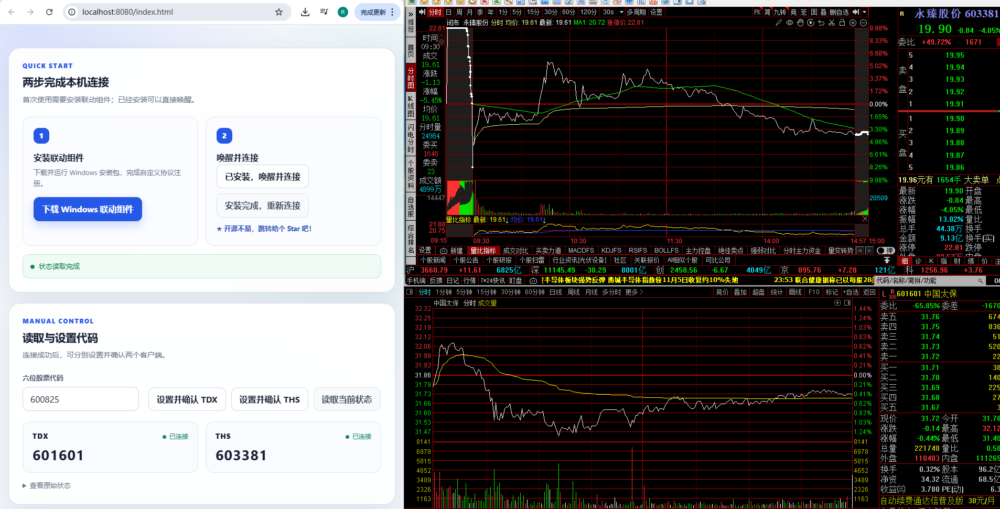
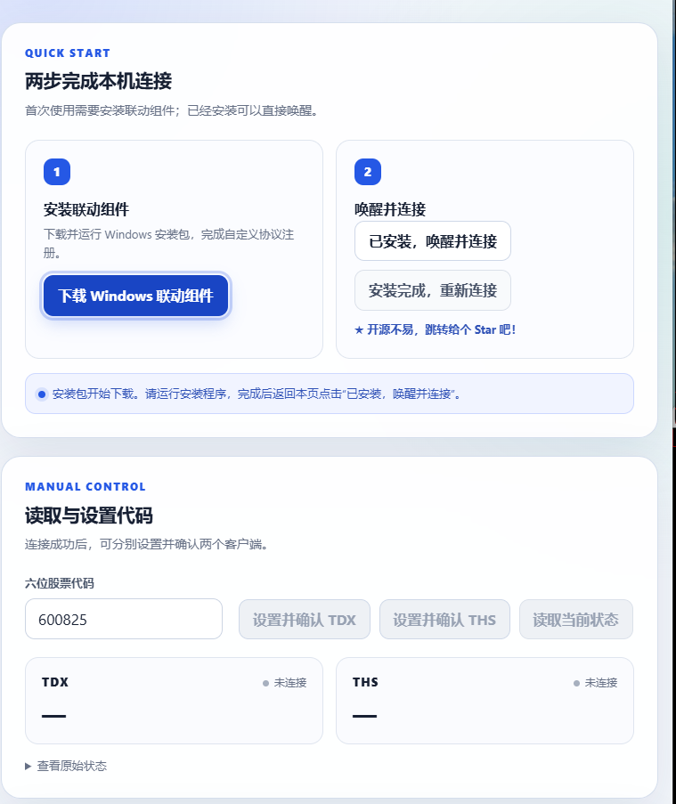
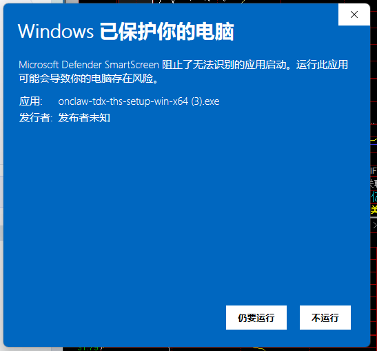
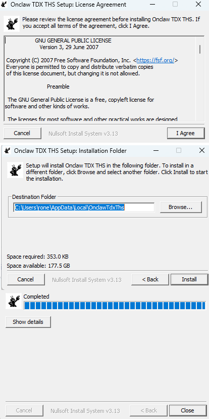
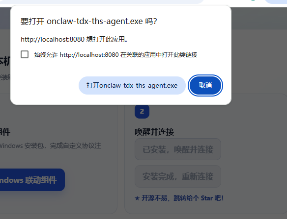
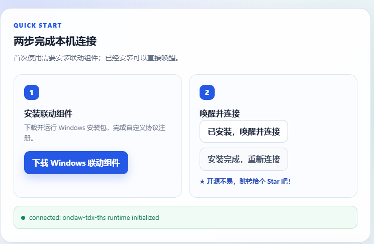

<p align="center">
  
</p>

<h1 align="center">TDX / THS Linker</h1>

<p align="center">
  Windows 通达信与同花顺本地联动服务
</p>

<p align="center">
  <a href="examples/web-quickstart/README.md">Web 快速接入</a>
  ·
  <a href="docs/protocol.md">本地协议</a>
  ·
  <a href="docs/architecture.md">架构说明</a>
</p>

<p align="center">
  <a href="https://raw.githubusercontent.com/onclaw-dev/tdx-ths-linker/main/imgs/preview6.png">
    
  </a>
</p>

## 来自开发者的话

在使用 DeepSeek Harness 这类 AI 应用时，经常会看到一段值得验证的选股或分析逻辑，很想马上预览它对应的 K 线特征。但把代码一个个复制出来、再逐个输入交易软件，过程实在繁琐。如果能够让 AI 或工具提交代码，自己只用鼠标点一点，就能在熟悉的交易软件里快速查看结果，整个验证过程会自然很多。

从主观观察 K 线的效率来说，通达信与同花顺这类主流交易软件仍然有成熟、顺手的预览体验。因此，我先用 C++ 实现了通达信与同花顺之间的代码读取、设置和联动。完成桌面端联动后，又希望这套能力能够被不同技术栈直接复用：如果网页只需引入一个模块，就能获得相同的联动能力，那么 AI 应用、研究工具和临时页面都可以更快地把逻辑变成可观察的结果。

于是有了 TDX / THS Linker 的全场景适配。项目通过一套共享 C++ runtime 和单实例 Agent，为 Web、Node / Electron、Python、CLI、Harness，以及能够访问本机 HTTP 服务的 Windows 原生程序，提供统一的通达信、同花顺股票代码读取与设置能力。不同调用端不再分别持有桌面软件资源，而是共同复用一个本地联动服务。

TDX / THS Linker 是开源、免费的本地工具，不提供行情数据、证券推荐或交易能力。服务仅监听 `127.0.0.1`；npm 与 PyPI 不安装软件、不写注册表；只有用户主动运行 Web 安装包时，才会安装固定路径 Agent 并注册浏览器唤醒协议。

## 联动设计说明

项目只构建一份 `onclaw-tdx-ths-agent.exe`。npm、PyPI 与 Web 安装包使用完全相同的 Agent 二进制，但交付方式不同：

```text
Python / npm ── 内嵌裸 Agent ──┐
                              │
Web ── 可见安装包 + 协议注册 ──┼── http://127.0.0.1:17654
                              │
                              ▼
                     单一 Agent 服务进程
                     ├─ 状态读取与写入
                     ├─ 调用方请求去重
                     ├─ TDX / THS 独立调度
                     ├─ 300 ms 首尾合并
                     └─ 活跃唤醒与闲置释放
                              │
                              ▼
                         TDX / THS
```

- Python 与 npm 首先复用已经健康运行的 Agent。
- 如果 Web Agent 已安装但没有运行，两端优先启动固定安装路径中的 Agent。
- 如果尚未安装 Web Agent，两端直接启动各自包内的裸 Agent，不执行安装程序。
- Agent 使用固定端口和用户会话级单实例保护，保证同一时间只有一个服务进程持有联动资源。
- Web 安装包会停止此前由 Python 或 npm 启动的 Agent，安装同一二进制、注册 `onclaw-tdx-ths://`，再启动固定路径服务。
- 高频代码变化按目标端分别合并：立即处理第一个请求，并在 300 ms 窗口结束时至多处理最后一个不同代码。

当前支持 Windows x64。TDX 与 THS 是否可用取决于对应桌面程序是否正在运行以及当前版本是否受支持。

## 安装方式

### Python

通过 PyPI 安装：

```powershell
py -m pip install tdx-ths-linker
tdx-ths-linker-python ensure-agent
tdx-ths-linker-python --json --accept-license state
```

PyPI wheel 内嵌裸 Agent。首次使用会复用现有服务，或者直接启动包内 Agent；不会显示安装界面，也不会写入注册表。

Python API：

```python
from tdx_ths_linker import Client

with Client(license_accepted=True) as client:
    state = client.get_state()
    print(state.tdx.code, state.ths.code)

    # 明确指定目标端和六位代码
    result = client.set_code("tdx", "600825")
    print(result.accepted)
```

更多示例见 [Python Agent HTTP 示例](examples/python/README.md)。

### npm

通过 npm 安装：

```powershell
npm install tdx-ths-linker
npx --no-install tdx-ths-linker --json --accept-license state
```

npm 包内嵌相同的裸 Agent，不包含 `postinstall` 安装流程，也不会注册浏览器协议。

Node / Electron API：

```js
import { createAgentClient } from "tdx-ths-linker";
import { ensureAgent } from "tdx-ths-linker/runtime";

await ensureAgent();

const client = createAgentClient({ clientId: "my-app" });
await client.initialize(true);

const state = await client.getState();
console.log(state.tdx.code, state.ths.code);
```

CLI 设置示例：

```powershell
npx --no-install tdx-ths-linker --json --accept-license set 600825 --target tdx --wait
npx --no-install tdx-ths-linker --json --accept-license set 600825 --target ths --wait
```

更多说明见 [npm 客户端文档](packages/client/README.md) 和 [CLI / Harness 驱动说明](docs/driver.md)。

### Web

浏览器不能直接启动包内裸 Agent，也不能自行写入 Windows 注册表。Web 联动需要用户下载并运行带注册能力的安装包：

1. 下载 `onclaw-tdx-ths-setup-win-x64.exe`。
2. 在可见安装界面中确认许可和安装位置。
3. 安装包接管当前 Agent，注册 `onclaw-tdx-ths://` 并启动服务。
4. 网页由用户点击唤醒协议，为当前精确 Origin 授予进程期写权限。
5. 网页通过 `http://127.0.0.1:17654/v1/*` 读取状态和提交代码。

<p align="center">
  <a href="https://raw.githubusercontent.com/onclaw-dev/tdx-ths-linker/main/imgs/preview1.png"></a>
  <a href="https://raw.githubusercontent.com/onclaw-dev/tdx-ths-linker/main/imgs/preview2.png"></a>
  <a href="https://raw.githubusercontent.com/onclaw-dev/tdx-ths-linker/main/imgs/preview3.png"></a>
  <a href="https://raw.githubusercontent.com/onclaw-dev/tdx-ths-linker/main/imgs/preview4.png"></a>
  <a href="https://raw.githubusercontent.com/onclaw-dev/tdx-ths-linker/main/imgs/preview5.png"></a>
  <a href="https://raw.githubusercontent.com/onclaw-dev/tdx-ths-linker/main/imgs/preview6.png"></a>
</p>

安装包下载地址：

<https://fin.onclaw.cc/linker/onclaw-tdx-ths-setup-win-x64.exe>

完整接入流程、Origin 授权规则、Python `requests` 示例和 Web 页面代码见 [Web 快速接入文档](examples/web-quickstart/README.md)。

## License

GPL-3.0-only
