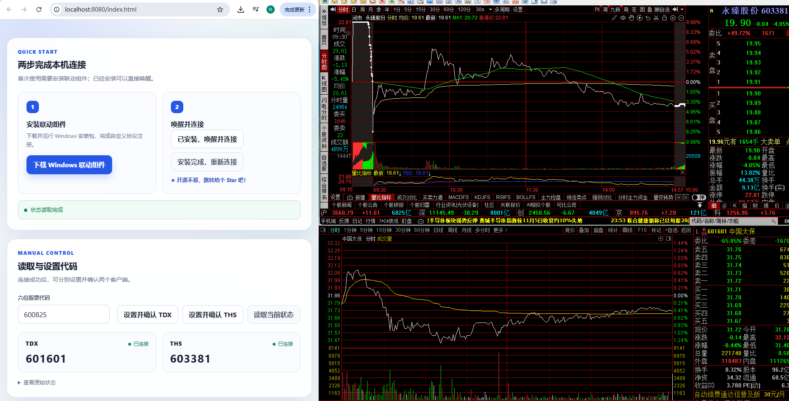
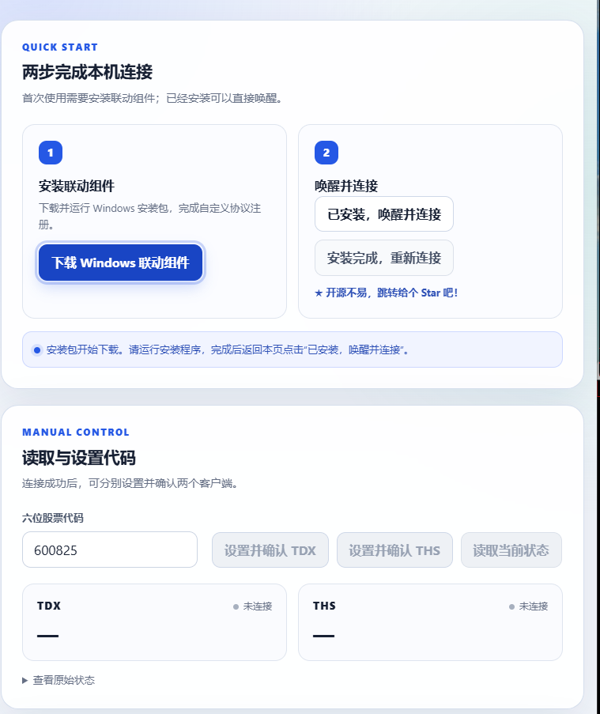
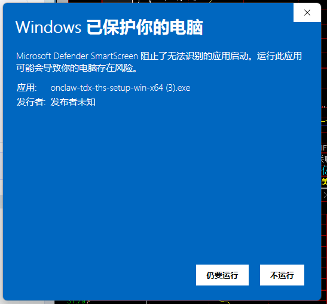
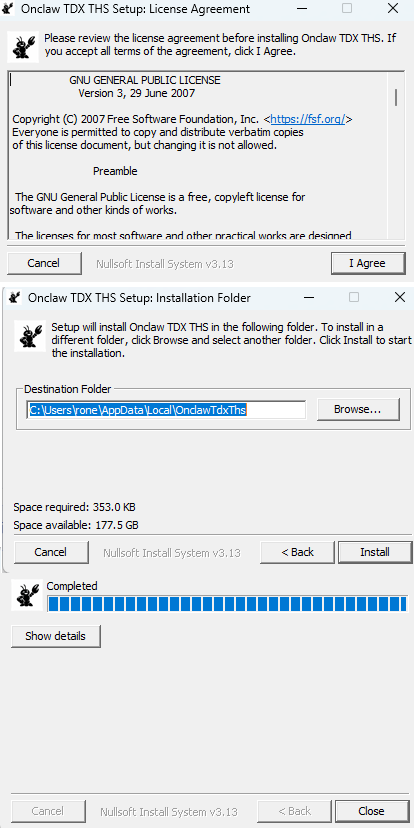
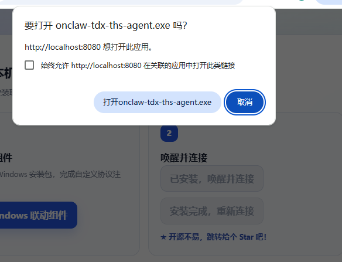
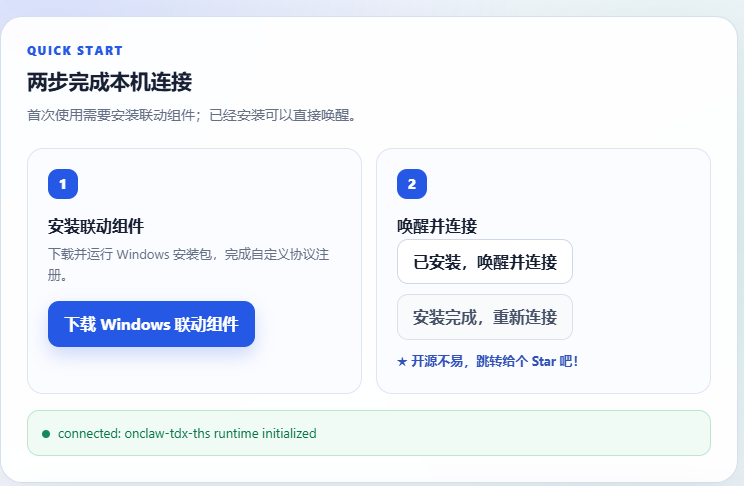

<p align="center">
  
</p>

<h1 align="center">Web 网页端快速接入</h1>

<p align="center">
  通过浏览器唤醒本机 Agent，实现通达信（TDX）与同花顺（THS）的代码读取、设置和单向自动联动。
</p>

<p align="center">
  <a href="../../README.md">项目主页</a>
  ·
  <a href="https://fin.onclaw.cc/linker/onclaw-tdx-ths-setup-win-x64.exe">下载 Windows 联动组件</a>
</p>

## 效果预览

Web 页面与 TDX、THS 同时运行时，可以在网页端读取两端当前代码，分别发送代码，并选择单向自动联动。

<p align="center">
  <a href="../../imgs/preview6.png">
    
  </a>
</p>

上图展示了完整工作状态：

- Web 页面通过本机 Agent 与桌面软件通信。
- TDX 与 THS 状态卡分别显示连接状态和当前代码。
- 网页可以单独设置 TDX 或 THS，并等待目标端读回确认。
- 自动联动仅支持明确的单向模式，避免双向同步产生循环写入。

### 六步使用流程

点击下方任意图片，可跳转到对应的详细说明：

<table>
  <tr>
    <td align="center"><a href="#flow-download"></a><br><strong>1. 下载 Agent</strong></td>
    <td align="center"><a href="#flow-smartscreen"></a><br><strong>2. 允许运行</strong></td>
    <td align="center"><a href="#flow-install"></a><br><strong>3. 完成安装</strong></td>
  </tr>
  <tr>
    <td align="center"><a href="#flow-activate"></a><br><strong>4. 唤醒 Agent</strong></td>
    <td align="center"><a href="#flow-connected"></a><br><strong>5. 确认连接</strong></td>
    <td align="center"><a href="#flow-result"></a><br><strong>6. 验证联动</strong></td>
  </tr>
</table>

## 组件与协议说明

### 工作链路

```text
HTTPS / localhost Web 页面
          │
          │ onclaw-tdx-ths://activate
          ▼
Windows Agent（用户目录安装）
          │
          │ http://127.0.0.1:17654/v1/*
          ▼
共享 C++ runtime ── TDX / THS
```

浏览器受安全沙箱限制，不能直接读取其他 Windows 进程的内存，也不能直接加载本项目的 DLL。为此，本项目提供一个本机代理 EXE（Agent）：安装包负责安装 Agent 并注册 `onclaw-tdx-ths://`，网页先用该协议授予当前 Origin 写权限，再通过只监听本机回环地址的 HTTP API 完成读取和写入。

Agent 实现并维护的是两层协议：

1. `onclaw-tdx-ths://`：由浏览器真实用户操作触发，用于启动 Agent，并授予网页 `Origin` 进程期写权限。
2. `http://127.0.0.1:17654/v1/*`：用于无 session 初始化 runtime、读取状态和设置代码。

Agent 只在内存中保存当前进程已授权的 Origin，不在网页中暴露 TDX、THS 的进程内存，也不把股票代码或授权信息保存到安装目录。授权在 Agent 退出后自动清空。

### 安装位置与监听参数

| 参数 | 值 | 说明 |
| --- | --- | --- |
| 安装目录 | `%LOCALAPPDATA%\OnclawTdxThs` | 当前 Windows 用户独立安装，不需要系统级目录 |
| Agent | `onclaw-tdx-ths-agent.exe` | 自定义协议处理程序和本地转发服务 |
| 自定义协议 | `onclaw-tdx-ths://` | 由真实用户点击触发，用于唤醒 Agent |
| HTTP 地址 | `http://127.0.0.1:17654` | 仅监听本机，不绑定局域网或公网 |
| 协议版本 | `1` | 当前激活与 HTTP 合约版本 |
| 支持平台 | Windows x64 | Web 页面必须运行在 Windows 浏览器中 |
| 页面来源 | HTTPS 或 `http://localhost` | 普通远程 HTTP 和 `file://` 不允许联动 |

### 浏览器唤醒协议

网页在用户点击“已安装，唤醒并连接”时打开：

```text
onclaw-tdx-ths://activate?v=1&origin=<网页Origin>
```

| 参数 | 必填 | 说明 |
| --- | --- | --- |
| `v` | 是 | 激活协议版本，当前为 `1` |
| `origin` | 是 | 发起连接的精确网页 Origin，例如 `http://localhost:8080` |

Agent 不接受额外参数、重复参数或不安全 Origin。浏览器询问是否打开外部应用时，必须由用户明确确认。

### 本地 HTTP API

| 方法与路径 | 认证 | 用途 |
| --- | --- | --- |
| `GET /v1/health` | 无 | 检查 Agent、协议版本和当前 Origin 写权限 |
| `POST /v1/initialize` | 无 | 幂等初始化 runtime；安装器已完成许可证确认 |
| `GET /v1/state` | 无 | 读取 TDX、THS 可用性与当前代码，并唤醒空闲 runtime |
| `POST /v1/set-code` | 已授权 Origin | 向明确的 `tdx` 或 `ths` 发送六位代码 |

网页写入会携带精确 Origin；不存在短期 session。高频写入按目标在 300 ms 内执行首值并只保留最后一个不同尾值。页面仍会继续读取状态，直到目标端返回指定代码才显示确认成功。

### Python requests 协议示例

下面用 Python 展示网页 SDK 在后台执行的完整协议。自定义协议不是 HTTP 接口，因此先用 `webbrowser.open()` 唤醒已安装的 Agent；之后才使用 `requests` 访问回环 HTTP API。

安装依赖：

```powershell
py -m pip install requests
```

完整请求流程：

```python
import json
import secrets
import time
import urllib.parse
import webbrowser

import requests

BASE_URL = "http://127.0.0.1:17654"
ORIGIN = "http://localhost:8080"
CODE = "600825"

# 1. 通过自定义协议唤醒 Agent，并授权当前 Origin 写入。
activation_url = "onclaw-tdx-ths://activate?" + urllib.parse.urlencode(
    {"v": "1", "origin": ORIGIN}
)
webbrowser.open(activation_url)

# 2. 等待本机 Agent 开始监听。所有请求都必须携带精确 Origin。
origin_headers = {"Origin": ORIGIN}
deadline = time.monotonic() + 10
while True:
    try:
        health = requests.get(
            f"{BASE_URL}/v1/health", headers=origin_headers, timeout=1
        )
        health.raise_for_status()
        if health.json().get("writeAuthorized"):
            break
    except requests.RequestException:
        if time.monotonic() >= deadline:
            raise RuntimeError("Agent 未在 10 秒内启动")
        time.sleep(0.25)

# 3. 初始化共享 runtime，不领取或保存短期 token。
initialized = requests.post(
    f"{BASE_URL}/v1/initialize",
    headers=origin_headers,
    json={"licenseAccepted": True},
    timeout=2,
)
initialized.raise_for_status()

# 4. 读取 TDX、THS 当前状态。
state = requests.get(
    f"{BASE_URL}/v1/state", headers=origin_headers, timeout=2
)
state.raise_for_status()
print(json.dumps(state.json(), ensure_ascii=False, indent=2))

# 5. 设置一个目标；target 改为 ths 即可写入 THS。
command = requests.post(
    f"{BASE_URL}/v1/set-code",
    headers=origin_headers,
    json={
        "target": "tdx",
        "code": CODE,
        "clientId": "python-example",
        "requestId": "request-" + secrets.token_hex(16),
    },
    timeout=2,
)
command.raise_for_status()
print(json.dumps(command.json(), ensure_ascii=False, indent=2))
```

`requests` 会根据 `BASE_URL` 自动生成正确的 `Host: 127.0.0.1:17654`，使用 `json=` 时也会自动设置 `Content-Type: application/json`。`ORIGIN` 必须与激活 URI 中的 `origin` 完全一致；生产网页应替换为自己的 HTTPS Origin。

#### 1. 健康检查

请求没有 JSON 正文。典型响应：

```json
{
  "ok": true,
  "protocolVersion": 1,
  "agentVersion": "0.1.4",
  "writableTargets": ["tdx", "ths"],
  "writeAuthorized": true
}
```

客户端必须确认 `protocolVersion` 为 `1`，版本不匹配时不能继续写入。

#### 2. 初始化 runtime

请求 JSON：

```json
{
  "licenseAccepted": true
}
```

响应 JSON：

```json
{
  "ok": true,
  "licenseState": "accepted",
  "message": "runtime initialization started",
  "runtimeHealth": "initializing"
}
```

安装时已展示并确认 GPL-3.0-only 许可证；该字段用于明确初始化请求，不需要网页再次显示复选框。

#### 3. 读取 TDX、THS 状态

请求没有 JSON 正文。响应中的 `tdx` 与 `ths` 使用同一结构，例如：

```json
{
  "initialized": true,
  "isSupported": true,
  "active": true,
  "lastActivityAt": 0,
  "runtimeHealth": "ready",
  "licenseState": "accepted",
  "message": "runtime ready",
  "tdx": {
    "name": "tdx",
    "code": "600825",
    "health": "ready",
    "lastError": "",
    "updatedAt": 0,
    "lastScanAt": 0,
    "lastResolvedOffset": 0,
    "available": true,
    "usingFallback": false,
    "directRead": true,
    "pid": 1234
  },
  "ths": {
    "name": "ths",
    "code": "600825",
    "health": "ready",
    "lastError": "",
    "updatedAt": 0,
    "lastScanAt": 0,
    "lastResolvedOffset": 0,
    "available": true,
    "usingFallback": false,
    "directRead": true,
    "pid": 5678
  }
}
```

时间、偏移量和 PID 均为运行时示例值，接入方不应把它们写死。

#### 4. 设置代码

请求 JSON：

```json
{
  "target": "tdx",
  "code": "600825",
  "clientId": "web-稳定调用方标识",
  "requestId": "request-单次请求标识"
}
```

| 字段 | 允许值 | 说明 |
| --- | --- | --- |
| `target` | `tdx` 或 `ths` | 必须明确指定一个目标，不能同时写两端 |
| `code` | 六位 ASCII 数字 | 例如 `600825`、`002131` |
| `clientId` | 1–128 个安全字符 | 调用方归属标识，不是认证凭据 |
| `requestId` | 1–128 个安全字符 | 单次请求幂等标识 |

响应 JSON：

```json
{
  "ok": true,
  "accepted": true,
  "status": "accepted",
  "target": "tdx",
  "code": "600825",
  "clientId": "web-example",
  "requestId": "request-example",
  "message": "command queued"
}
```

`accepted: true` 表示命令被调度器接受；`status` 可能是 `accepted`、`coalesced` 或 `duplicate`。它不代表桌面软件已经切换成功。可靠接入必须继续轮询 `GET /v1/state`，直到对应目标的 `code` 等于请求值，或在业务设定的超时时间后返回失败。

#### 常见错误响应

错误统一使用 JSON，例如：

```json
{
  "error": "invalid_origin"
}
```

| `error` | 含义 |
| --- | --- |
| `invalid_host` | 请求 Host 不是 `127.0.0.1:17654` |
| `invalid_origin` | Origin 格式不安全 |
| `origin_not_authorized` | 浏览器 Origin 尚未通过自定义协议获得写权限 |
| `invalid_caller_identity` | `clientId` 或 `requestId` 缺失或格式无效 |
| `not_found` | 请求路径不存在 |

### Agent 维护参数

这些参数主要由安装器调用，普通网页使用者不需要手动执行：

| 参数 | 作用 |
| --- | --- |
| `--register` | 注册 `onclaw-tdx-ths://` 到当前用户 |
| `--repair` | 重新写入并验证协议注册 |
| `--verify-registration` | 检查协议是否指向当前 Agent |
| `--unregister` | 移除当前用户的协议注册 |

## 安装指令

<a id="flow-download"></a>

### 第 1 步：从网页下载安装包

在 quickstart 页面点击“下载 Windows 联动组件”。正式下载地址为：

<https://fin.onclaw.cc/linker/onclaw-tdx-ths-setup-win-x64.exe>

<p align="center">
  <a href="../../imgs/preview1.png">
    
  </a>
</p>

浏览器只能下载安装包，不能自动运行 EXE。下载完成后需要从浏览器下载列表或文件管理器手动打开。

<a id="flow-smartscreen"></a>

### 第 2 步：允许 Windows 运行安装包

当前安装包如果尚未完成代码签名，Microsoft Defender SmartScreen 可能显示“Windows 已保护你的电脑”。请确认文件来自上述官方地址；如需继续，点击“更多信息”后选择“仍要运行”。

<p align="center">
  <a href="../../imgs/preview2.png">
    
  </a>
</p>

> 不要运行来自聊天附件、网盘转载或未知镜像的同名 EXE。正式 Release 提供校验值时，应同时核对 `SHA256SUMS.txt`。

<a id="flow-install"></a>

### 第 3 步：接受许可证并完成安装

安装器依次展示 GPL-3.0-only 许可证、当前用户安装目录和安装进度：

1. 阅读许可证并点击 `I Agree`。
2. 确认安装目录，点击 `Install`。
3. 等待状态变为 `Completed`，点击 `Close`。

<p align="center">
  <a href="../../imgs/preview3.png">
    
  </a>
</p>

安装完成后，`onclaw-tdx-ths://` 已指向当前用户目录中的 Agent。卸载程序会同时移除该协议注册。

### 本地运行示例

本仓库的 HTML 示例使用固定版本 npm ESM CDN，无需前端构建：

```powershell
py -m http.server 8080 --directory examples/web-quickstart
```

使用 Windows 浏览器打开：

<http://localhost:8080/index.html>

生产项目应通过 npm 和 bundler 管理依赖：

```powershell
npm install tdx-ths-linker
```

```ts
import { createWebLinker } from "tdx-ths-linker";

const linker = createWebLinker({
  installerUrl: "https://fin.onclaw.cc/linker/onclaw-tdx-ths-setup-win-x64.exe",
});
```

## 测试指令

<a id="flow-activate"></a>

### 第 1 步：从浏览器唤醒 Agent

安装完成后返回页面，点击“已安装，唤醒并连接”。浏览器会显示外部应用确认框：

<p align="center">
  <a href="../../imgs/preview4.png">
    
  </a>
</p>

点击“打开 `onclaw-tdx-ths-agent.exe`”。如果这是受信任的固定站点，可以勾选“始终允许此站点在关联的应用中打开此类链接”；共享设备不建议勾选。

<a id="flow-connected"></a>

### 第 2 步：确认连接状态

Agent 被唤醒后，页面会轮询 `127.0.0.1:17654`、领取 session 并初始化 runtime。成功状态如下：

<p align="center">
  <a href="../../imgs/preview5.png">
    
  </a>
</p>

状态栏出现 `connected` 后，读取和设置按钮会变为可用。如果一直显示不可用，应检查：

- 页面是否通过 HTTPS 或 `http://localhost` 打开。
- 浏览器是否允许打开外部应用及访问本地网络。
- Windows 防火墙或安全软件是否阻止 Agent。
- `127.0.0.1:17654` 是否被其他进程占用。

<a id="flow-result"></a>

### 第 3 步：验证双端读写和联动

1. 启动 TDX 与 THS，并进入能够显示股票代码的页面。
2. 点击“读取当前状态”，确认两个状态卡都显示“已连接”。
3. 输入明确的六位测试代码。
4. 点击“设置并确认 TDX”，等待 TDX 状态卡返回目标代码。
5. 点击“设置并确认 THS”，等待 THS 状态卡返回目标代码。
6. 再次读取，确认两端均为目标代码。
7. 如需自动联动，选择一个明确方向并点击“启动轮询”；测试完成后点击“停止轮询”。

<p align="center">
  <a href="../../imgs/preview6.png">
    
  </a>
</p>

真实桌面自动验收可使用仓库的 opt-in live validation：

```powershell
$env:ONCLAW_LIVE_TEST = "1"
$env:ONCLAW_LIVE_CODE = "<六位测试代码>"
$env:TDX_THS_LINKER_LICENSE_ACCEPTED = "1"
npm run test:live:native
```

## 测试结果返回示例

以下 JSON 仅表示稳定结果结构，不代表当前机器已经通过真实桌面验收：

```json
{
  "channel": "web-agent",
  "status": "passed",
  "reads": {
    "tdx": true,
    "ths": true
  },
  "writes": {
    "tdx": {
      "accepted": true,
      "confirmed": true
    },
    "ths": {
      "accepted": true,
      "confirmed": true
    }
  },
  "finalCodesMatch": true
}
```

只有初始读取、TDX 写入确认、THS 写入确认和最终双端读取全部成功，才能把该渠道标记为 `passed`。
